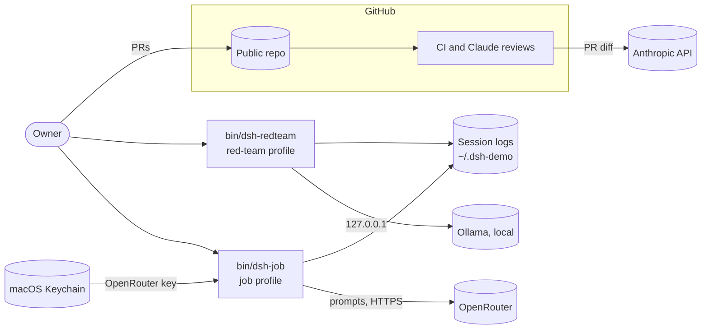

# Threat model — DeepSeek demo implementation

Living document. Update it when a new entry point, data store, external service or agent tool is added. Last reviewed: 2026-11-09. Adopted from the repo template (ADR 0016); the defences themselves are decided in [docs/adr/](adr/).

## 1. System overview

Two dsh profiles run on the owner's Mac, each started by its launcher in `bin/`. The job profile talks to OpenRouter. The red-team profile talks only to local Ollama. CI runs on GitHub and sends PR diffs to Anthropic for the Claude reviews.

Trust boundaries: the Mac and the outside world; the model and the harness (model output is untrusted); the repo's owner and anyone else who can open an issue, comment or fork.

## 2. Assets

| Asset | Why it matters | Where it lives |
|---|---|---|
| OpenRouter API key | Spend, account takeover | macOS Keychain (ADR 0007, `secrets.md`) |
| `CLAUDE_CODE_OAUTH_TOKEN` | The owner's Claude subscription | GitHub Actions secret, read only by `claude-review.yml` |
| Files on the owner's Mac (`~/.ssh`, other repos) | Privacy, credentials | Local disk, outside the workspaces |
| Session logs | Prompts and tool results, possibly sensitive | `~/.dsh-demo/home/sessions` and `~/.dsh-demo/redteam/home/sessions`, directories mode 0700 |
| Repos the secrets filter scans (M7) | Real candidate secrets | Local disk; values never leave the machine (ADR 0004) |
| Unfixed upstream bugs | Disclosure before a fix | `eval/embargoed/`, gitignored (ADR 0015) |

## 3. Verification target

OWASP ASVS 5.0 level: **L1**. The harness has no accounts and stores no user data beyond the owner's own session logs.

## 4. Threats

STRIDE for the classic part. Status: open / mitigated / accepted.

| ID | Threat | Component | Mitigation | Status |
|---|---|---|---|---|
| T1 | Leaked secret in repo or logs | repo, CI | gitleaks in lefthook and CI (full history), GitHub secret scanning with push protection; Keychain (ADR 0007) | mitigated |
| T2 | Malicious or compromised dependency | build | Lockfiles, 7-day cooldown, `trustPolicy: no-downgrade`, OSV-Scanner, Dependabot alerts; malware alerts once the manual step in `SETUP.md` is done | partly mitigated |
| T3 | Compromised GitHub Action | CI | Actions allowlist, SHAs required, `permissions: {}` default, zizmor | mitigated |
| T4 | Unreviewed change reaches `main` | repo | PR-only rulesets on `main` and `development`, required `ci-ok`, CODEOWNERS (ADR 0016) | accepted (solo) |
| T5 | Stranger-written issue or comment steers a CI agent | CI | No CI job can push; same-repo PRs only; reviews read only owner, member and collaborator text (ADR 0014) | mitigated |
| T6 | Model output in a CI log runs a workflow command | CI | Printed model text is wrapped in `stop-commands`; annotation messages escape `%` and newlines, and file names also `:` and `,` | mitigated |
| T7 | A public review comment discloses an unfixed upstream bug | CI | PRs labelled `embargo` skip the Claude reviews (ADR 0015) | mitigated |
| T8 | Third-party review bots (Codex, SonarQube Cloud) read the repo or act on comments | GitHub apps | Installed by the owner; read their permissions and who can trigger them in Settings → Integrations | open |
| T9 | Personal data in git history | repo | New commits use the GitHub noreply address, and `pre-push.sh` refuses any other author or committer email; older commits keep theirs | accepted |
| T10 | A launcher passes the caller's environment or a key file to dsh | launchers | Both re-run with an empty environment plus an allowlist and refuse `.env`, `.credentials.yaml` and instruction files; tested by `scripts/checks/launchers.sh` | mitigated |

## 5. Agentic threats

Edition-tagged: OWASP Top 10 for LLM Applications **2026**, OWASP Top 10 for Agentic Applications (**ASI**, Dec 2025). Until the defences land (ADR 0012), most rows are mitigated by taking the tool away, not by a defence. Each defence milestone replaces "tool off" with a scored defence.

| Risk | How it could happen here | Mitigation | Test / eval | Status |
|---|---|---|---|---|
| LLM01 Prompt Injection / ASI01 Agent Goal Hijack | A scanned file or tool result steers the agent | Now: no web, shell or instruction-loading tools; no file tools in the job profile. Later: injection filter and taint (ADR 0003, M5) | Red-team attack set (M2) | partly mitigated |
| LLM02 Sensitive Information Disclosure | The job model reads a local file and sends it to OpenRouter | Now: job profile has no file tools. Later: read allowlist (M4); masked findings (ADR 0004) | Canary (M3) | partly mitigated |
| LLM03 Excessive Agency / ASI02 Tool Misuse | The agent has tools beyond the task | Bundles turn off every tool not listed in `agent-policy.md`; read-only sandbox; `approval: ask`, denied headless | `config.yml` snapshot in the upgrade check | mitigated for now |
| ASI03 Identity & Privilege Abuse | A shell reads the Keychain item through `security` without a prompt | No shell or PTC in either profile (ADR 0003, ADR 0007) | `config.yml` snapshot | mitigated for now |
| LLM04 Supply Chain / ASI04 Agentic Supply Chain | Malicious dsh release, MCP server or model | dsh pinned exactly with the upgrade check (ADR 0001); only our own plugins (ADR 0012); no MCP servers yet. Gap: OpenRouter model ids and Ollama tags can change behind the same name | `pnpm check:upgrade` | partly mitigated |
| ASI05 Unexpected Code Execution | Model-written code runs on the host | Bash, pwsh, PTC and workflows are off in both profiles | `config.yml` snapshot | mitigated |
| LLM05 Data and Model Poisoning / ASI06 Memory & Context Poisoning | A file one run leaves steers the next | No memory in v1 (ADR 0010); instruction and skill rows off; launchers refuse instruction files in the workspace | `launchers.sh` | mitigated |
| ASI07 Insecure Inter-Agent Communication | A subagent's answer skips the tool hooks (research/dsh-async-taint.md) | Subagent, job and goal tools off (ADR 0013) | Control-plane tests (M4) | mitigated for now |
| LLM06 Unbounded Consumption / ASI08 Cascading Failures | A loop burns tokens or money | OpenRouter key credit limit of $30 a month (ADR 0006); per-turn tool-call cap (M4) | — | partly mitigated |
| LLM08 Hidden Context Exposure | System prompt or a secret leaks in output | No secrets in prompts; keys stay out of the session log and `--dump-config` | Canary (M3) | partly mitigated |
| LLM10 Improper Output Handling | Model output reaches a shell, path or tool call | CI validates the security review's structured output; the harness has no executor for model output yet (ADR 0013) | Control-plane tests (M4) | partly mitigated |
| ASI09 Human-Agent Trust Exploitation | The owner approves a harmful action the agent framed as safe | Headless runs deny every approval; the interactive profile (v1.1) must show the exact action | — | open for v1.1 |
| ASI10 Rogue Agents | The agent acts outside its task with no record | Session log uncompressed; hash-chained ledger (M3, ADR 0013) | — | open |

Not applicable yet: LLM07 Misinformation (no user-facing answers are relied on) and LLM09 Vector and Embedding Weaknesses (no RAG).

NIST SP 800-218A tasks covered: PW.1.1 (this section), PW.4.4 (pinned dsh and plugins), PW.5.1 (structured output validated in CI), RV.1.3 (SECURITY.md scope).

## 6. Accepted risks

| Risk | Why accepted | Revisit |
|---|---|---|
| No non-author review | Solo maintainer (ADR 0016) | When a second maintainer joins |
| Claude Code's deny rules don't stop every way a shell can read a file or a Keychain item | A `Bash(...)` deny list can't cover every command; Claude Code's sandbox is the real boundary | When the sandbox is enabled for this repo |
| The red-team profile's file tools can read anything on disk, including the job profile's session logs | Its model is local and it has no shell or network tool | M4, when the read allowlist lands |
| OpenRouter routes requests to any provider, and dsh refuses `data_collection` and `zdr` routing fields (research/openrouter-models.md) | Set in the owner's OpenRouter account privacy settings instead | When dsh allows routing fields |
| Older commits carry the owner's personal email and machine hostname | A rewrite can't reach `refs/pull/*`, and both are already public | — |
