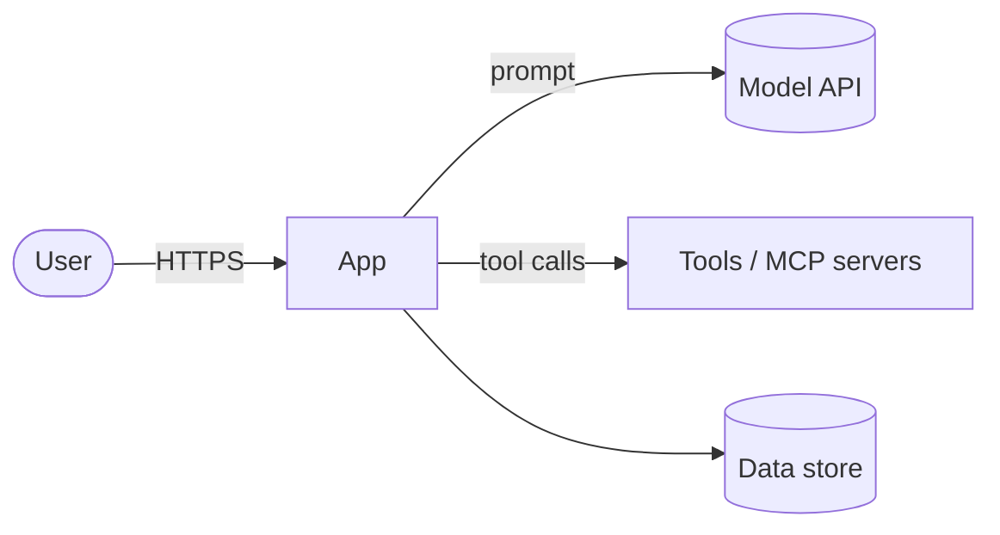

# Threat model — DeepSeek demo implementation

Living document. Update it when a new entry point, data store, external service or agent tool is added. Last reviewed: _YYYY-MM-DD_. Adopted from the repo template (ADR 0016); the defences themselves are decided in [docs/adr/](adr/).

## 1. System overview

_Describe the components and draw the data flow. Mark trust boundaries._

## 2. Assets

| Asset | Why it matters | Where it lives |
|---|---|---|
| API keys / secrets | Account takeover, spend | macOS Keychain (ADR 0007, see `secrets.md`) |
| User data | Privacy, legal | _…_ |

## 3. Verification target

OWASP ASVS 5.0 level: **L1** _(raise to L2 when the app stores user data or has accounts)_.

## 4. Threats

Use STRIDE for the classic part. Status: open / mitigated / accepted.

| ID | Threat | Component | Mitigation | Status |
|---|---|---|---|---|
| T1 | Leaked secret in repo or logs | repo, CI | Gitleaks in lefthook + CI (full history), GitHub push protection; Keychain (ADR 0007) | mitigated |
| T2 | Malicious or compromised dependency | build | Lockfiles, 7-day cooldown, OSV-Scanner, Dependabot malware alerts | mitigated |
| T3 | Compromised GitHub Action | CI | Actions pinned to SHAs, `permissions: {}` default, zizmor | mitigated |
| T4 | Unreviewed change reaches main | repo | PR-only rulesets on `main` and `development`, required checks, CODEOWNERS, ADR 0016 | accepted (solo) |
| T5 | Stranger-written issue or comment steers a CI agent that can push | CI | Same-repo PRs only; reviews read only owner/member/collaborator text; protected-path filter (ADR 0014) | mitigated |

## 5. Agentic threats

Edition-tagged: OWASP Top 10 for LLM Applications **2026**, OWASP Top 10 for Agentic Applications (**ASI**, Dec 2025). Fill in one row per relevant risk; delete rows that do not apply and say why.

| Risk | How it could happen here | Mitigation | Test / eval | Status |
|---|---|---|---|---|
| LLM01 Prompt Injection / ASI01 Agent Goal Hijack | Untrusted web/RAG/file content steers the agent | Content marked untrusted; tool allowlist; approval for side effects | `evals/` red-team cases | open |
| LLM03 Excessive Agency / ASI02 Tool Misuse | Agent has broader tools than the task needs | Per-task tool allowlist in `agent-policy.md` | eval: refuses out-of-scope tools | open |
| ASI03 Identity & Privilege Abuse | Agent reuses user or service credentials | Scoped, short-lived credentials per tool | — | open |
| ASI04 Agentic Supply Chain | Malicious MCP server, tool definition or model | Pinned MCP servers and model IDs; reviewed tool definitions | — | open |
| ASI05 Unexpected Code Execution | Model-generated code runs on the host | Sandbox: rootless container, no network, read-only FS, no secrets | — | open |
| ASI06 Memory & Context Poisoning | Persisted memory stores attacker content | Provenance on memory entries; expiry; review | — | open |
| LLM06 Unbounded Consumption / ASI08 Cascading Failures | Loops or retries burn tokens or money | Iteration, token and cost budgets; provider spend caps | eval: stops at budget | open |
| LLM08 Hidden Context Exposure | System prompt or secrets leak in output | No secrets in prompts; output filtering | eval: prompt-leak cases | open |
| LLM10 Improper Output Handling | Model output reaches shell/SQL/HTML | Schema validation before use; parameterised calls | unit tests | open |
| ASI09 Human-Agent Trust Exploitation | User approves a harmful action the agent framed as safe | Show exact action and diff before approval | — | open |

NIST SP 800-218A tasks covered: PW.1.1 (this section), PW.4.4 (pinned models/MCP), PW.5.1 (output validation), RV.1.1 (model I/O logging, see `slo.md`), RV.1.3 (SECURITY.md scope).

## 6. Accepted risks

| Risk | Why accepted | Revisit |
|---|---|---|
| No non-author review | Solo maintainer (ADR 0016) | When a second maintainer joins |
| Claude Code's `Read` deny rules for `.env*` and key files don't stop shell commands (`cat`, `python -c`) reading them | A `Bash(...)` deny list can't cover every way to read a file; Claude Code's sandbox is the real boundary | When the sandbox is enabled for this repo |
